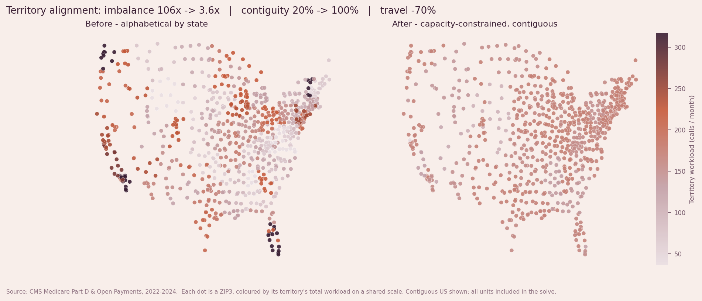
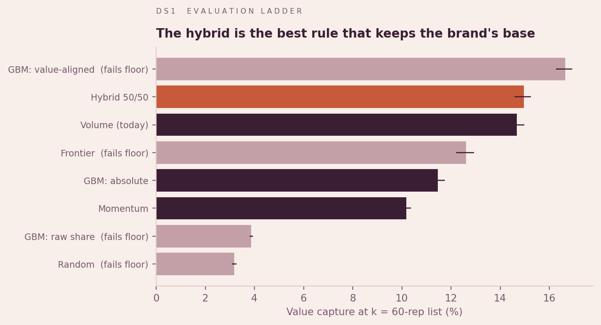
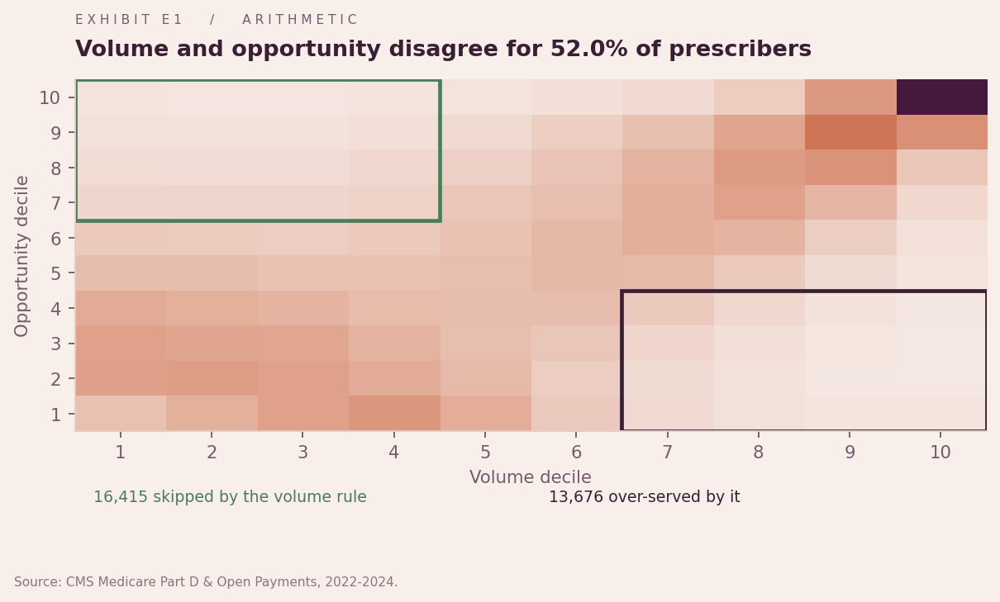
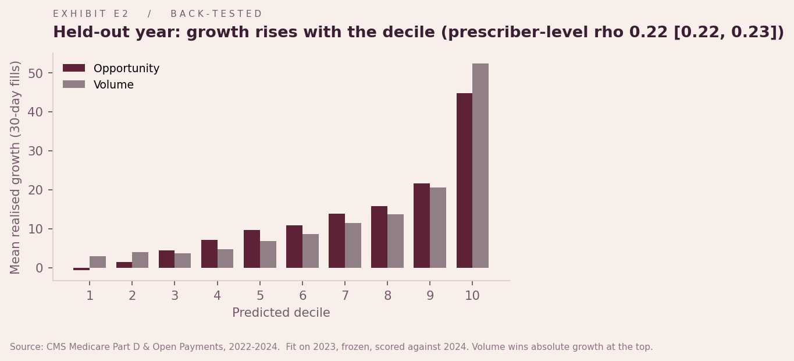
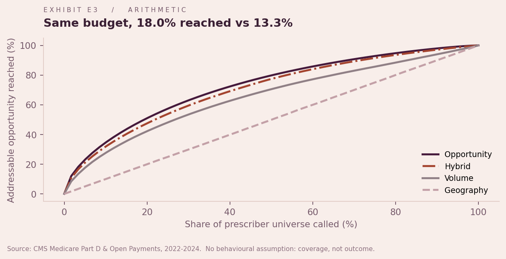
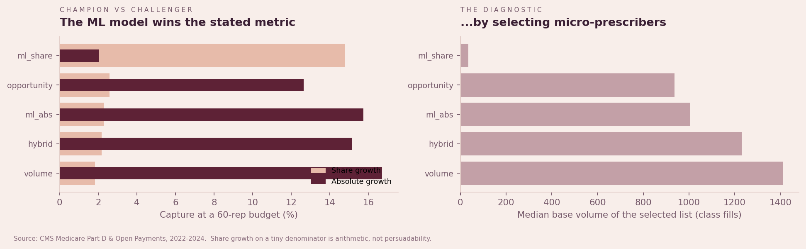
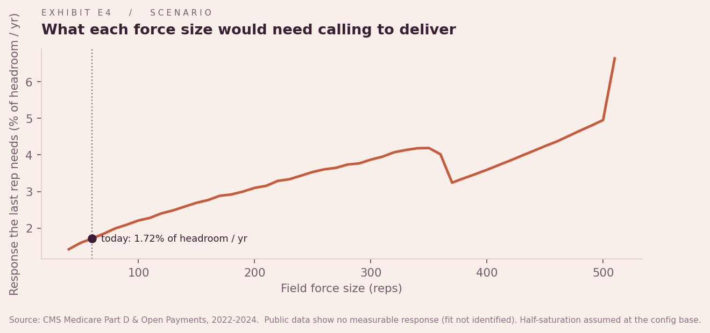
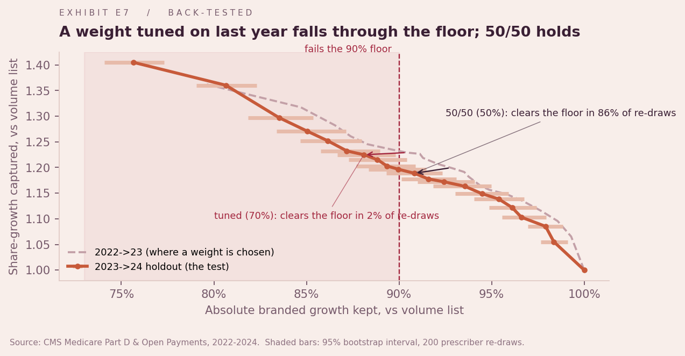
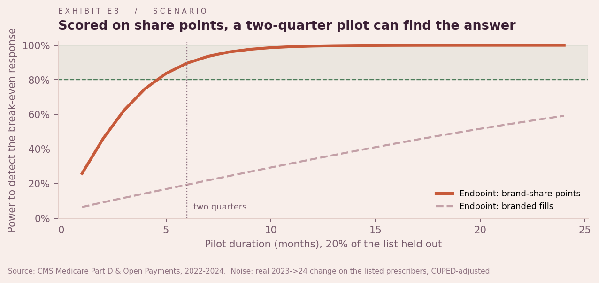
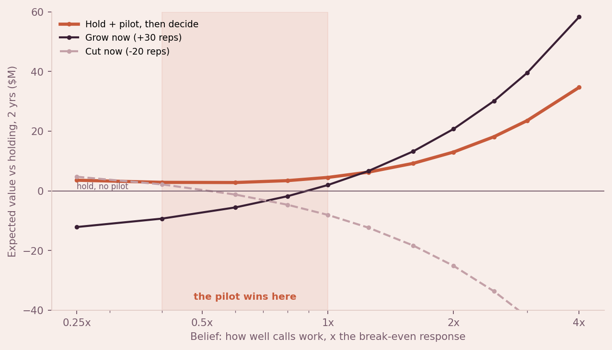

# PharmaTarget

**Re-target the same 60 reps on a blended opportunity + volume ranking, hold
headcount, and redraw the territories.** In a year the model never saw, that
list captured **1.19× [1.16, 1.21]** the share gains of today's volume-ranked
list while keeping **91% [89%, 92%]** of its absolute growth. Same reps, same cost.

A field-strategy engagement for a branded DOAC (modelled on apixaban), built
end to end on **real** CMS data: ~39 GB of Medicare Part D and Open Payments
files covering **1,380,665 prescribers** (267,171 who write the class),
2022–2024. Four questions: who to call on, how often, how many reps, and how
to draw the map.



*Each dot is a ZIP3, coloured by its territory's total monthly workload on a
shared scale. Left: territories drawn alphabetically by state. Right:
capacity-constrained and contiguity-repaired. Same 60 reps.*

---

## The answer, with its evidence class

Every claim is tagged by what kind of claim it is: **BACK-TESTED** (validated
on the 2024 hold-out year), **ARITHMETIC** (no behavioural assumption), or
**SCENARIO / ASSOCIATION** (rests on a model of response, or is correlational).

| # | Recommendation | Evidence | Class |
|---|---|---|---|
| 1 | **Re-target on the 50/50 hybrid ranking** | Realised 2024 share capture 2.2% vs 1.8% for volume (1.19×), absolute 15.2% vs 16.7% (0.91×); clears the 90% floor in **86%** of bootstrap re-draws, where a weight tuned on 2022→23 clears it in 2% | BACK-TESTED |
| 2 | **Hold 60 reps, and run a 20% hold-out pilot scored on share points** — worth about $4.5M over two years against deciding blind, with the lowest worst-case regret | Public data show no measurable call response; the 60th rep pays only if a year of calls captures ≥ **1.72%** of remaining opportunity. Scored on brand-share points, a two-quarter pilot detects that with **90%** power; scored on branded fills, with 19% | SCENARIO |
| 3 | **Redraw the territories** | Workload imbalance 106× → **3.6×**, contiguity 20% → **100%**, travel 235 → **70 mi** | ARITHMETIC |
| 4 | **Do not read promotion as causal** | Paid prescribers were already gaining share faster *before* payment (+1.0 pt, p < 0.001) | ASSOCIATION |

---

## The business problem

Northwind Pharma markets a branded DOAC with a fixed field force of 60 reps,
roughly $15M/year fully loaded, and flat share. The force is targeted the way
the industry targets by default: rank prescribers by prescription volume, call
the top deciles.

That rule cannot see headroom. A cardiologist writing 400 class fills at 91%
brand share has almost nothing left to win; an internist writing 120 at 6%
share with an elderly, high-risk panel has a great deal. The model estimates
**opportunity** — what a strong comparable prescriber reaches, minus what this
one gives the brand today — and the two rankings disagree by two or more
deciles for **52.0%** of in-market prescribers.

But the back-test then showed that neither pure rule is the answer, and that
is the most useful finding in the project.

## Key findings

**1. The opportunity ranking predicts where share moves** · *back-tested*

Fit on 2023, frozen, scored against 2024. 95% intervals are a 400-draw
prescriber bootstrap.

| | Estimate | 95% CI |
|---|---|---|
| Flagged vs **propensity-matched** controls (5 covariates, 39,727 pairs, worst SMD 0.053) | **1.40×** branded growth; +4.9 fills | [3.8, 6.0] |
| Share-growth capture vs volume rule (top 20%) | **1.25×** | [1.24, 1.27] |
| Absolute-growth capture vs volume rule (top 20%) | 0.82× — volume wins | [0.81, 0.83] |
| Prescriber-level rank correlation, opportunity vs realised growth | 0.22 | [0.218, 0.225] |

Gate G3 (ordering, beats volume on share, no micro-prescriber gaming) **passes**.

**τ is a tuning choice, not the finding.** Refitting the frontier across
τ ∈ [0.65, 0.90]: within ±0.05 of 0.80 the ranking correlates **ρ ≥ 0.988**
with the baseline and keeps **≥ 94%** of the top three deciles; worst case
ρ 0.950 at ±0.15.

**2. Each pure rule wins one metric — so the decision is the blend** · *back-tested*

Realised 2024 outcomes of each rule's list at the size 60 reps can actually
serve (8,878 prescribers):

| Targeting rule | Share capture | Absolute capture | Net branded fills | Median base |
|---|---|---|---|---|
| ML trained on share growth | 14.8% | 2.0% | +140,059 | 35 fills |
| Opportunity (this model) | 2.6% | 12.6% | +619,001 | 936 |
| **Hybrid (opportunity + volume)** | **2.2%** | **15.2%** | **+715,980** | 1,230 |
| ML trained on absolute growth | 2.3% | 15.7% | +793,691 | 1,004 |
| Volume (status quo) | 1.8% | **16.7%** | +731,958 | 1,411 |

Pure opportunity wins share but gives up a quarter of the absolute growth —
a brand team will not trade away its base for share points. The recommendation
is therefore chosen by a **rule written into the code before the comparison
was read** (`challenger.recommend_rule`): *the highest share capture among the
explainable rules, subject to keeping ≥ 90% of the volume rule's absolute
growth.* Only the hybrid and volume qualify; the hybrid wins.

The ML-on-absolute-growth model edges both, but it is a black box a rep
cannot be told the reasons for, and it is excluded by design.

**2b. Is 50/50 the right blend, or a number nobody chose?** · *back-tested*

The hybrid's absolute-growth ratio, **0.91 [0.89, 0.92]**, sits right on the
90% floor, so the weight had to be tested rather than assumed
(`src/models/decision.py`). Every opportunity weight from 0% to 100% was
scored on the same 8,878-prescriber budget, **chosen on the 2022→23 market and
read on the 2023→24 holdout**:

| Weight | Chosen on 2022→23 | 2024 share vs volume | 2024 growth kept | P(clears floor) |
|---|---|---|---|---|
| 70%, the floor-maximising weight in 2022→23 | 90.4% kept | 1.23× | **88.1%** | **2%** |
| **50%, the recommendation** | 92.8% kept | **1.19×** | **90.8%** | **86%** |
| 45%, if the brand team wants 95% confidence | 93.5% kept | 1.18× | 91.6% | 98% |

The frontier keeps its shape but shifts a couple of points a year, so a
weight tuned to sit exactly on the floor is a coin toss the next year. Equal
weight was never tuned and had a 2.8-point margin, which is why it holds.
The floor is re-read at every annual refresh.

**The challenger that "won".** An ML model trained on share growth beat every
rule on the share metric by **selecting prescribers writing a median of 35
fills**, where share swings on a single prescription. That is why gate G3
carries an anti-gaming condition, and why share capture is never reported
alone.

**3. Headcount cannot be sized from public data — hold, and measure** · *scenario*

60 reps serve **8,870 of 267,171** in-market prescribers (3.3%) at full
capacity; the unconstrained call plan wants ~106,900.

The call-response curve was fitted on the closest public proxy for a rep
visit — Open Payments food-and-beverage events **that name the brand** —
within volume-decile strata. It shows **no measurable dose-response**
(the fit sits on its bounds, weighted R² < 0). An earlier version counted
every Pfizer and Janssen meal, including vaccines and Xarelto, as an Eliquis
call; once attribution is by product, the apparent response disappears.

So the model does not price headcount on a curve it cannot measure. It
reports instead the **break-even response**: today's 60th rep pays for itself
only if a year of calls captures at least **1.72%** of a prescriber's
remaining opportunity (half-saturation 12 calls/yr, assumed).

**The pilot has to be able to see that number, and the endpoint decides
whether it can.** On the listed prescribers, the break-even effect is 7.5
branded fills a year against year-on-year noise of 196 (signal-to-noise
0.04): branded fills are dominated by practice size. In brand-share points
it is 0.57 points against 4.7 (0.12, three times better). With a 20% random
hold-out, a CUPED prior-year adjustment and the real noise of these
prescribers:

| Design, two quarters | Endpoint: share points | Endpoint: branded fills |
|---|---|---|
| 20% prescriber hold-out | **90%** power | 19% |
| Territory split, 30 v 30 (ICC 0.011) | 70% | 16% |

So the recommendation is specific: hold out 20% of the new list for two
quarters, score both arms on brand-share change, keep absolute fills as a
guardrail, and read it at month six. Below half of break-even, the force is
larger than calling justifies; above twice break-even, the headcount case
reopens with a measured number.

**The business case, priced under uncertainty** · *scenario* (`src/models/value.py`)

Contribution is exactly linear in the call response, so every headcount
decision can be valued for any response, with hiring ($60k per rep,
6-month ramp at half productivity) and severance costs included. The
pilot's cost is what the held-out prescribers forgo while their calls go to the
next names on the list (8.5% of the list's contribution for six months).

| Two-year value vs holding, if calls truly work… | 0.25× b-e | 0.5× b-e | 1.0× b-e | 2.0× b-e | 4.0× b-e | Worst regret |
|---|---|---|---|---|---|---|
| **Hold + pilot, then decide** | $4.3M | $2.0M | $-1.8M | $0.6M | $15.5M | **$13.4M** |
| Hold, no pilot | $0.0M | $0.0M | $0.0M | $0.0M | $0.0M | $28.9M |
| Grow now (+30 reps) | $-13.9M | $-11.1M | $-5.4M | $6.0M | $28.9M | $20.3M |
| Cut now (−20 reps) | $6.4M | $3.8M | $-1.4M | $-11.8M | $-32.5M | $61.4M |

* **Re-targeting:** $4.2M a year at the break-even response
  ($2.1M–$8.3M for 0.5–2×),
  at zero incremental cost.
* **The pilot:** for a belief centred on break-even, hold-and-pilot is worth
  **$4.5M** over two years against holding blind, and $2.5M more than
  the best decision made without it. It is the best strategy for any belief
  from **0.4× to 1.0×** break-even, and it has the **lowest worst-case regret**
  of any option.
* **Hiring:** a full recruiting cycle pays only if calls beat break-even by
  **1.48×**. No public evidence supports that.

**The price is falling under the analysis.** CMS's negotiated 2026 Medicare
price for a 30-day supply of the brand is $231, against the $380 net assumed
here. That leaves re-targeting untouched, because it costs nothing, but it
raises the break-even response for every Medicare rep by 1.65× (to about
2.8%). It is a further reason to measure before hiring.

Priced at that break-even response, re-targeting is worth about **$4.2M a
year** at identical cost. That figure is **modelled** — it values the
opportunity model's own view — and is shown only alongside the realised
comparison in finding 2.

**4. Territories: contiguous, balanced, and still compact** · *arithmetic*

| Alignment, 60 reps | Imbalance (max ÷ min) | Workload CV | Contiguous | Travel / call |
|---|---|---|---|---|
| Alphabetical by state (how it is done without analytics) | 106× | 0.62 | 20% | 235 mi |
| Plain workload-weighted k-means (the obvious analytics) | 523× | 0.83 | 98% | 49 mi |
| **Capacitated + contiguity repair + balance pass** | **3.6×** | **0.127** | **100%** | 70 mi |

k-means is the most compact map and the least usable: one rep gets 500× the
workload of another. The capacity and balance steps buy implementability for
21 extra miles per call. Gate G4 (contiguity ≥ 95%, CV ≤ 0.20) **passes**.

**5. Promotional payments: association only** · *association*

| Estimate (brand-share points, 2023 → 2024) | Value |
|---|---|
| Paid vs unpaid, naive | +0.0076 |
| Difference-in-differences, unmatched | −0.0025 [−0.0064, +0.0014] |
| Difference-in-differences, propensity-matched (7,844 pairs) | +0.0120 [+0.0064, +0.0176] |
| **Pre-period gap** (treated already gaining share faster) | **+0.0101, p < 0.001** |

The parallel-trends test **failed**, and the matched estimate is about the
size of the pre-existing gap — so nothing here separates promotion from the
trend the paid prescribers were already on. Per the pre-committed protocol in
[CHARTER.md](CHARTER.md), all causal language is removed.

**6. Suppression hides 13.7% of claim volume, concentrated in small prescribers** · *arithmetic*

| Prescriber size | Share of their volume hidden |
|---|---|
| <100 claims | **68.7%** |
| 100–500 | 43.3% |
| 500–2,000 | 21.6% |
| 2,000+ | 8.6% |

Hidden class volume is imputed, **capped at what the unobserved class drugs
can physically hold** (≤ 10 claims each); the cap binds for 16% of in-market
prescriber-years and imputation adds 9.6% to class volume. Brand share is
measured on observed volume only, because which drug a suppressed row
belonged to is unknowable.

**7. Segmentation, on the addressable market only** · *arithmetic*

k = 7 over 282,182 in-market prescribers (silhouette 0.255, bootstrap ARI
0.859 across 25 resamples), named by rule from centroids relative to each
other: Steady Core 24%, Loyal Advocates 20%, Untapped Potential 13% (share
0.19, the conversion target), Rising Switchers 6% (+0.48 share trajectory),
Eroding Base 5%, Mainstream Writers 4%, Low-Value Tail 28%.

---

## The data science

The modelling is held to a data-science review, not just a business one. Everything
below runs in `src/ds/`, is tracked in MLflow, is shown in the app's **Model Lab**, and
is written up in **[docs/TECHNICAL_REPORT.md](docs/TECHNICAL_REPORT.md)** with a
[model card](docs/MODEL_CARD.md) and a [data card](docs/DATA_CARD.md).

| Question a reviewer asks | What was done | Result |
|---|---|---|
| Is it evaluated properly? | Ladder of 8 rules (random → volume → momentum → frontier → hybrid → three GBMs); primary metric, guardrail and k **declared before results were read**; precision@k, NDCG@k, gain curves, bootstrap CIs | Hybrid wins under the guardrail (14.9% value capture vs 14.7% volume, 3.2% random) |
| Is the target right? | Empirical-Bayes (beta-binomial) shrinkage, precision weighting, value-aligned target | Found **regression to the mean** (corr -0.563) behind the ML share "win"; value-aligned target fixes it (2.0% → 13.3% absolute capture) |
| How uncertain is it? | Two-part forecast: P(still writes the brand) + conformalised quantile regression | Hurdle AUC 0.870; 90% intervals cover 90.0% in period, 89.3% out of time |
| Where is it wrong, and for whom? | Errors and list representation by specialty, size, region, rural | Rural fair (ratio 0.93); primary care and NP/PA long tail under-reached → non-personal channels |
| What is causal? | Double ML with cross-fitted GBMs + Cinelli–Hazlett sensitivity | +0.65 share pts [0.43, 0.87] vs +1.60 naive; robustness value 1.1%: fragile → pilot |
| Who is persuadable? | Doubly-robust uplift learner, value-aligned, Qini on held-out folds | Monotone decile staircase (rank corr 0.988); recommend an **uplift arm in the pilot** |
| Why does it say that? | Exact TreeSHAP from an XGBoost replica, per prescriber (Targets drawer) | Fidelity ρ 0.973; agreement with permutation importance ρ 0.94 |
| Which choices matter? | Seven ablations | Practice features carry the model (-4.7 pts without them); two simpler variants pre-declared for next year, not adopted on the test set |
| Is it safe next year? | PSI + KS drift, concept-drift check, data contracts, MLflow | All inputs stable; 58/58 contract checks pass; retrain triggered: False |
| Do peers matter? | CMS group-practice network (17,447 practices) | Share clusters within practice (ICC 0.163 vs 0.003 chance) but peers add little prediction; 39% of value sits with unlisted practice-mates → randomise the pilot by practice |



---

## What this audit changed

The project was audited line by line in October 2026, and several published
numbers did not survive. They are listed because a client would want to know,
and because how a number was wrong is often worth more than the number.

| Was published | What was wrong | Now |
|---|---|---|
| "$18.1M a year from retargeting" | Half of the 60-rep list were prescribers who write **no** anticoagulants (74% of all "opportunity" sat with non-writers); the comparison also wins by construction | Non-writers score zero; the decision rests on realised outcomes; $4.2M shown as modelled only |
| "Break-even at 63 reps" | Response fitted on every Pfizer/Janssen meal, competitors' included | Brand-attributed visits show no measurable response → hold and pilot |
| Frontier coverage 0.785; G3 1.0 / 1.4× / 0.8×; deck "0.507× faster" | **The test suite was writing fixture values into the real manifest** | Tests isolated (`tests/conftest.py`); coverage is 0.800 |
| "29× selection gap" | Divided an elasticity by a share-point difference | All estimates in share points (finding 5) |
| "Market covariates carry real weight" | Grouped, they carry 6% | Reported by group: practice & patients 76%, specialty 18%, market 6% |
| Brand share ~0.53 on average | Imputed hidden volume was counted as competitor volume, and was uncapped | Share on observed volume; imputation capped |

The rest of the change log is in [CONTEXT.md §0](CONTEXT.md).

---

## The exhibits

| | |
|---|---|
|  |  |
| **E1** — volume and opportunity rankings disagree | **E2** — the held-out year: growth rises with the decile |
|  |  |
| **E3** — modelled headroom reached on the same budget | **E6** — every rule's realised 60-rep outcome |
|  |  |
| **E4** — the response each force size would need | **E7** — the blend frontier: tuned weight drifts through the floor |
|  |  |
| **E8** — pilot power: share-point vs branded-fill endpoint | **E9** — every strategy against every belief: where the pilot wins |

**For a steering committee:**

| Document | What it is |
|---|---|
| **[PharmaTarget_Executive.pdf](outputs/PharmaTarget_Executive.pdf)** | 10 slides: answer, summary, problem, evidence, decision rule, map, headcount, business case, pilot, roadmap and the three approvals needed |
| **[PharmaTarget_OnePager.pdf](outputs/PharmaTarget_OnePager.pdf)** | One-page decision memo |
| [PharmaTarget_Recommendations.pdf](outputs/PharmaTarget_Recommendations.pdf) | The full 24-page analysis: the appendix |
| `/brief` in the app | Present mode: the same 10 slides, live and interactive (arrow keys, F for full screen) |

All three PDFs are generated from the pipeline output by
`python -m src.report.make_assets`, and the app serves them at
`/api/download/{executive,onepager,full}`. Every figure and every slide is generated
from the pipeline output by `python -m src.report.make_assets` — nothing is
typed in.

## Run it

```bash
pip install -r requirements.lock && python -m src.pipeline --synthetic --sample && python -m uvicorn api.main:app
```

About three minutes from a fresh clone, no downloads, no API keys — then open
<http://localhost:8000>. (`make install-lock && make demo` does the same.) A
fresh clone is tested exactly this way: all twelve stages including the
data-science layer, the reports, then every API route.

For real CMS data, put the source files in `dataset/` and run the resumable
runner on any OS:

```bash
python -m src.run            # only the stale stages; --list shows which those are
```

A stage is skipped when its artifact is newer than every source it depends
on, so an interrupted run resumes and a fix re-runs exactly what it touches.
`run_all.ps1` is a thin Windows wrapper over it. `src/pipeline.py` (used by
CI) runs the same stages in one process. Read the findings at any point with
`python -m src.utils.summary`.

**Deployment.** `Dockerfile` and `render.yaml` serve the slim bundle in
`data/deploy/` (top 50,000 prescribers by opportunity plus every aggregate,
rebuilt by the pipeline's `deploy-bundle` stage). It is not currently live;
`/api/meta` reports `data_scope` so a deployment always states that the
browsable list is a subset.

| Command | What it does |
|---|---|
| `make demo` | Synthetic sample pipeline, then serve on :8000 (~3 min) |
| `make download` | Fetch CMS sources (streamed and filtered) |
| `make run` / `make stages` | Resumable runner on real data / list what is stale |
| `make web-install && make web` | Frontend dev server on :5173 |
| `make test` | 232 Python tests (plus 73 frontend tests via `make web-test`) |
| `make ci` | Everything CI checks: lint, tests, web typecheck, tests and build |
| `make docker` | Build and run the production image (non-root, health-checked) |
| `mlflow ui --backend-store-uri ./mlruns` | Every tracked model run: parameters, metrics, artifacts |

### The app

Seven sections in a plum-and-terracotta editorial theme, every number read
from the API:

| Section | What it is for |
|---|---|
| **Overview** | The answer in one sentence, three decisions with their evidence class, and the interactive exhibits behind them (disagreement matrix, reach scrubber, five-rule race) |
| **The Case** | Situation-complication-question-answer, an issue tree whose verdicts are computed from the pipeline, a flip-card red team, a 36-week roadmap with KPIs, a risk matrix and kill criteria |
| **Model Lab** | The data science: evaluation ladder and gain curves, the regression-to-the-mean trap, conformal coverage and calibration, errors and representation, double ML with sensitivity, uplift Qini and deciles, SHAP and ablations, drift, contracts and the practice network |
| **Decision Lab** | Four exhibits to drag, ending with the business case under uncertainty (your belief, its spread and the horizon; payoff and regret matrix; value stack). The first three: the blend frontier (weight slider, bootstrap probability of clearing the floor), a headcount explorer (call response and net-price sliders, with the 2026 Medicare price marked), and a pilot designer (endpoint, design, duration, hold-out size, CUPED) |
| **Present (`/brief`)** | The 10-slide brief, full screen, with the interactive exhibits in place of pictures |
| **Call List** | The page a rep works from: pick a territory and get its prescribers in visit order, with calls per month, one sentence on why (the top TreeSHAP driver, in plain units) and the 2025 forecast range. Export to CSV or print. The territory sits in the URL (`/app/calls?t=3`), so a manager can send each rep their own list |
| **Targets · Territories · Response · Method** | The instruments: the prescriber list (its export matches the filters on screen), the alignment map, the promotion evidence, and the data and gates |

Charts are hand-rolled SVG with no charting library: draw-in animations,
tooltips, scrubbers, animated re-sorting, and full respect for
`prefers-reduced-motion`. Every text element on every route clears WCAG AA
contrast (checked in the browser across 2,600+ elements); the prescriber
drawer is a proper modal (focus moves in, Tab stays inside, Escape closes,
focus returns to the row); every page is code-split, so the app shell is 4 KB
gzipped and a page's code loads only when it is opened. The browser recomputes everything exactly from
pipeline anchors (marginal ROI is linear in the response and the price, and
power is a closed form), so dragging never runs a model.

### On the synthetic mode

The repo ships a generator emitting files with the exact CMS column names and
the same structural quirks, so the ETL cannot tell synthetic from real.
**It validates the pipeline, not the finding** — the generative process
encodes the hypothesis the model tests. Every artifact is stamped `SYNTHETIC`
and the UI shows a non-dismissible banner.

---

## Method

```
dataset/ (~39 GB) ──► stream + filter ──► DuckDB marts ──► sklearn ──► FastAPI ──► React
                       ~1.3 GB kept        4.13M rows        parquet     12 routes
```

**Ingest.** The Part D drug file is streamed, keeping class rows while
accumulating a per-prescriber total across *all* drugs — the suppression
reconciliation needs Σ(all drug rows), and filtering first would destroy it.
Local Open Payments files are filtered in DuckDB (vectorised, bounded memory),
keeping the five product-name fields so promotion can be attributed by
product. Manufacturer legal names are **discovered** per year, not guessed.

**Memory.** Every stage reads only the columns and years it needs, with the
filter pushed into the parquet reader, and floats as float32 — the full
real-data pipeline runs on a 16 GB laptop with a browser open.

**Potential and opportunity.** A histogram gradient-boosted **quantile**
regression at τ = 0.80 predicts log class volume from practice and market
covariates only; in-sample coverage is **0.800**. A linear (corrected-OLS)
frontier ranks prescribers similarly (Spearman 0.867). Then
`opportunity = potential × peer-achievable share − brand fills`, zero for
prescribers outside the class. The leakage guard raises, never warns.

**Hybrid rule.** The equal-weight mean of the opportunity and volume
percentile ranks, declared once (`opportunity.hybrid_score`) — not tuned
against the hold-out year.

**Call plan.** A frequency matrix (opportunity decile × share band), then a
capacity cut: rank, fill 60 reps' diaries from the top, everyone past the
cut is no-call.

**Territories.** Capacitated k-means with contiguity repair, a squared-
deviation balance pass and boundary polish, on 896 ZIP3 units (Census
Gazetteer × CDC PLACES, population-weighted centroids). Every alignment is
scored against the same workload-weighted centroids.

---

## Limitations

1. **Medicare-only.** Part D excludes commercial and Medicaid patients and
   skews 65+; less distorting for a DOAC than most classes.
2. **~17-month data lag.** Data year 2024 was published May 2026.
3. **No rep call data.** The back-test shows where growth *happened*, not
   where a call would have *caused* it. No CMS-only design can separate the
   two — hence the pilot.
4. **The visit proxy is weak.** Brand-named meals under-count calls, and reps
   choose whom to see. "No measurable response" is a statement about the
   proxy, not proof that calls do nothing.
5. **Suppression bias remains** for the smallest prescribers (69% hidden).
6. **New-writer acquisition is not modelled**; non-writers score zero.
7. **PLACES has no atrial-fibrillation measure**; stroke, CHD and
   hypertension prevalence are proxies.
8. **Straight-line distance, indivisible ZIP3s, k-NN adjacency** rather than
   drive time, ZIP5 splits and real polygons.
9. **The territory model ignores** rep tenure, relationships and org
   boundaries, which dominate real alignment decisions.
10. **Economics are public benchmarks** (`config/economics.yaml`), not the
    client's actuals.

---

## Repo

```
config/      params.yaml, economics.yaml, manufacturers.yaml — every tunable
src/ingest/  streaming + DuckDB ingest, geography build, synthetic generator
src/sql/     01 staging → 03 suppression reconciliation → 05 marts
src/models/  opportunity · callplan · backtest · challenger · call_response
             sizing · territory · segmentation · response · robustness · decision · value
src/ds/      shrinkage · evaluation · conformal · errors · causal · uplift · explain
             ablation · drift · contracts · network · tracking (MLflow)
docs/        technical report, model card, data card (generated from the pipeline)
api/         18 routes, DuckDB over parquet, a cursor per request, filtering in SQL
web/         React 18 + TS + Vite, nine routes plus story and present modes, hand-rolled SVG charts
tests/       232 tests — manifest isolation, leakage guards, decision rule,
             contiguity floors, suppression identities, matching balance,
             API contracts against the deploy bundle, the runner's staleness logic
src/run.py   resumable, dependency-aware runner (run_all.ps1 wraps it on Windows)
.github/     CI: lint; tests, pipeline and reports under coverage; API smoke;
             web typecheck/tests/build; committed-build check; Docker health check
```

**Data sources:** [Part D Prescribers by Provider and Drug](https://data.cms.gov/provider-summary-by-type-of-service) ·
[Part D by Provider](https://data.cms.gov/provider-summary-by-type-of-service) ·
[Open Payments](https://openpaymentsdata.cms.gov/) ·
[Census Gazetteer ZCTA](https://www.census.gov/geographies/reference-files.html) ·
[CDC PLACES](https://data.cdc.gov/)

`data/` and `dataset/` are gitignored except the deploy bundle. See
[CHARTER.md](CHARTER.md) for the pre-committed protocol — including what was to
happen if the back-test failed, decided before it was run.
