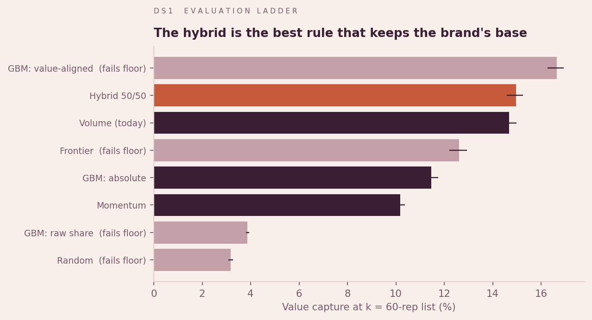
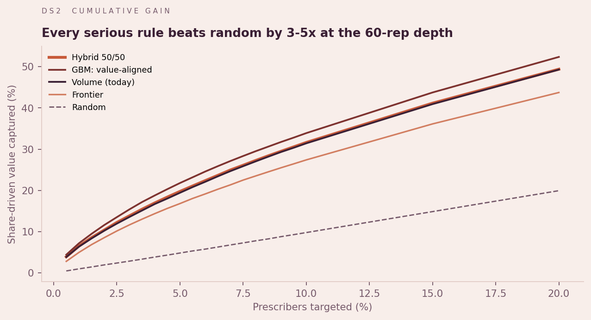
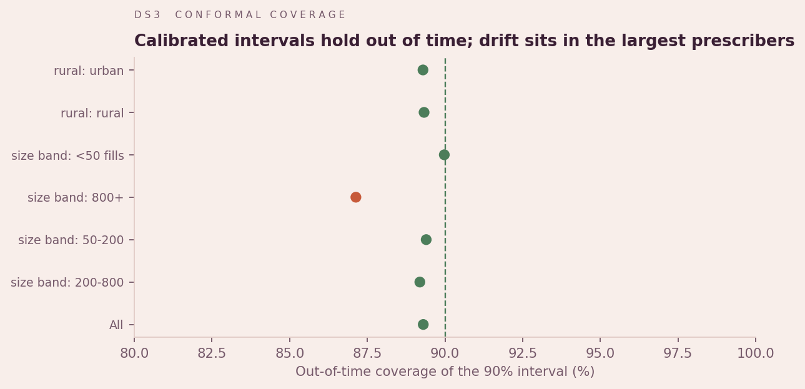
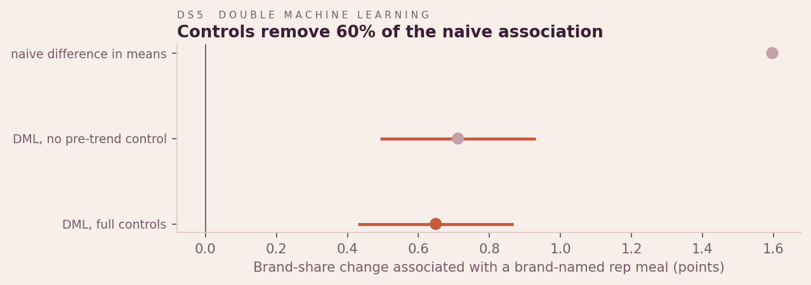
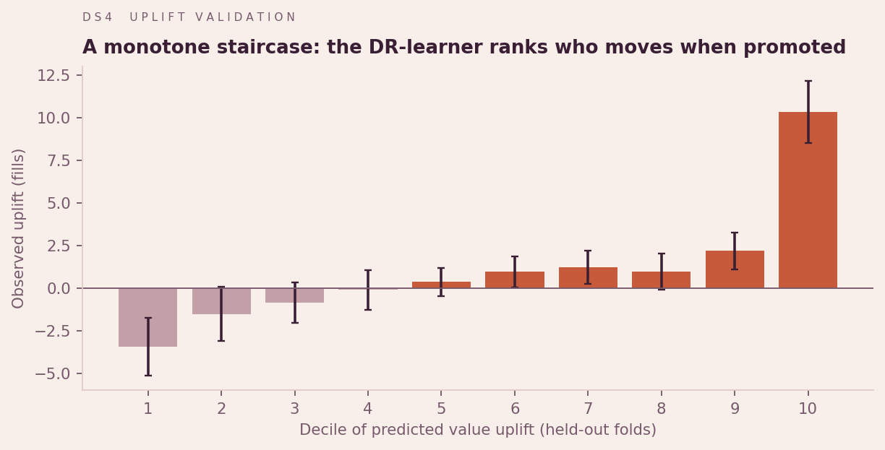
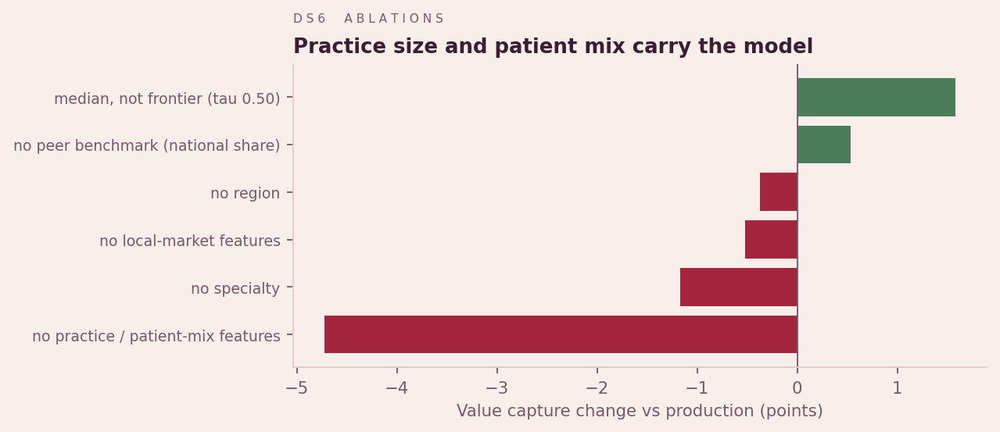

# PharmaTarget: technical report

*Generated 2026-10-31 from the pipeline output. Figures in `outputs/figures/DS*.png`.*

## 1. Problem
Rank about 267,000 Medicare anticoagulant prescribers so a 60-rep field force (k =
8878 prescribers a year) calls where calls are worth most, and quantify
how sure we can be.

## 2. Evaluation design
Out-of-time throughout: models learn on 2022 state -> 2023 outcomes and are judged on
2023 state -> 2024 outcomes. **Pre-declared** before any result was read: the primary
metric (value capture at k: the share of positive *share-driven fills* -- shrunk
share-point change x volume -- on the list), the guardrail (keep >= 90% of the volume
rule's absolute growth) and k.

| Rule | Value capture @k [95% CI] | Abs capture | Precision@k | NDCG@k | Passes guardrail |
|---|---|---|---|---|---|
| GBM: value-aligned | 16.7% [16.3%, 16.9%] | 13.3% | 0.582 | 0.567 | no |
| Hybrid 50/50 | 14.9% [14.6%, 15.2%] | 15.2% | 0.516 | 0.514 | yes |
| Volume (today) | 14.7% [14.3%, 15.0%] | 16.7% | 0.507 | 0.508 | yes |
| Frontier | 12.6% [12.2%, 12.9%] | 12.6% | 0.416 | 0.429 | no |
| GBM: absolute | 11.5% [11.1%, 11.7%] | 16.0% | 0.383 | 0.403 | yes |
| Momentum | 10.2% [9.9%, 10.4%] | 18.2% | 0.347 | 0.348 | yes |
| GBM: raw share | 3.9% [3.8%, 4.0%] | 2.1% | 0.049 | 0.119 | no |
| Random | 3.2% [3.1%, 3.3%] | 3.1% | 0.096 | 0.099 | no |

The hybrid wins under the guardrail, matching the consulting decision rule
(share 1.185x volume's, 91% of its
absolute growth); a blend weight tuned on the earlier year fails the floor out of time
(P = 2%) while 50/50 holds (P =
86%).

## 3. Target design: the regression-to-the-mean trap
A gradient-boosting model trained on raw share change "won" share capture by picking
prescribers with a median of 35.7 class fills and captured
2.0% of absolute growth. Beta-binomial shrinkage (prior strength
2.49 pseudo-fills) cut small prescribers' share-change s.d.
from 0.5407 to 0.3173, yet the
model still chose small prescribers; precision weighting did not help either. The cause is
regression to the mean (corr(share, change) = -0.563). Aligning
the target with value (share change x volume) fixes it: median 1092.1
fills, absolute capture 13.3%.

## 4. Uncertainty
Two-part model: P(still writes the brand), AUC 0.870, Brier
0.104; then conformalised quantile regression (Romano et al., 2019)
given that. Coverage of the 90% interval: 90.0% in period,
89.3% out of time; worst size band
87.1%. Mondrian (per-band) calibration:
89.2%. Point-forecast calibration slope
1.02.

## 5. Errors and representation
Forecast MAE 38.3 fills, relative bias -3.1%.
Rural representation ratio 0.93 (fair). Under-represented
relative to realised value: specialty_group=Advanced Practice, specialty_group=Hem/Onc, specialty_group=Nephrology, specialty_group=Neurology, specialty_group=Primary Care, size_band=200-800, size_band=50-200, size_band=<50 fills, region=Unknown.

## 6. Causal ML
Partially linear double machine learning (Chernozhukov et al., 2018), 5-fold cross-fitted
gradient-boosted nuisances, controls including each prescriber's own prior-year change.

| Specification | Treatment | Estimate (pts) | 95% CI |
|---|---|---|---|
| naive difference in means | any brand meal | +1.60 | -- |
| DML, no pre-trend control | any brand meal | +0.71 | [+0.49, +0.93] |
| DML, full controls | any brand meal | +0.65 | [+0.43, +0.87] |
| DML, full controls | log1p brand $ (dose) | +0.20 | [+0.14, +0.26] |

Sensitivity (Cinelli and Hazlett, 2020): robustness value 1.1%
(to zero), 0.7% (to insignificance) -- a confounder
1.87x as strong as the prior-year trend would
erase it. Reading: a small, fragile association; the pilot is the causal test.

## 7. Uplift
Doubly-robust learner (Kennedy, 2023), 4-fold cross-fitted, ranked and evaluated on value
uplift (effect x volume). Decile rank correlation 0.988 on
held-out folds. Held-out fill uplift on each 60-rep list: volume 22,417, opportunity 59,154, hybrid 36,787, uplift_share_points 185,865, uplift_value 202,024.
Share-point uplift reproduces the small-denominator trap (median 55.0 fills).

## 8. Explanations
Exact TreeSHAP from an XGBoost quantile replica: fidelity rho 0.973,
coverage 0.800, agreement with permutation importance rho
0.937.

## 9. Ablations
| Variant | Spearman vs production | Value capture | Change (pts) |
|---|---|---|---|
| production | 1.000 | 12.7% | +0.0 |
| no practice / patient-mix features | 0.221 | 8.0% | -4.7 |
| no local-market features | 0.979 | 12.1% | -0.5 |
| no specialty | 0.923 | 11.5% | -1.2 |
| no region | 0.975 | 12.3% | -0.4 |
| median, not frontier (tau 0.50) | 0.870 | 14.2% | +1.6 |
| no peer benchmark (national share) | 0.970 | 13.2% | +0.5 |

## 10. Monitoring and data quality
PSI 2023 -> 2024: score 0.000, worst input brand_share
0.027; concept drift (score-outcome rank correlation)
0.0217. Retrain triggered:
False. Data contracts: 58/58
passing. All runs are tracked in MLflow (`./mlruns`).

## 11. Practice network
71.1% of in-market prescribers matched to 17,447
group practices. Shrunk-share ICC within practice 0.163 vs a
permutation null of 0.003; peer features move value
capture 16.6% -> 16.7%.
Practices share prescribing levels, not changes; 39.1% of
value sits with unlisted practice-mates of the list.

## 12. Limitations
Medicare Part D only; ~17-month lag; no call data (meals are a proxy); observational causal
and uplift estimates; practice membership is a current snapshot.

## References
Chernozhukov et al. (2018) *Double/debiased machine learning*. Romano, Patterson and
Candes (2019) *Conformalized quantile regression*. Kennedy (2023) *Towards optimal
doubly robust estimation of heterogeneous causal effects*. Cinelli and Hazlett (2020)
*Making sense of sensitivity*. Efron and Morris (1975) *Data analysis using Stein's
estimator* (empirical Bayes).
